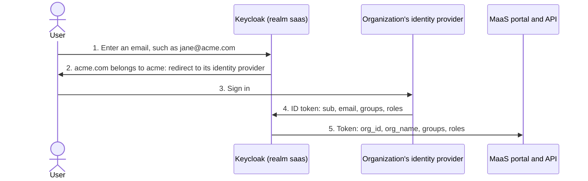
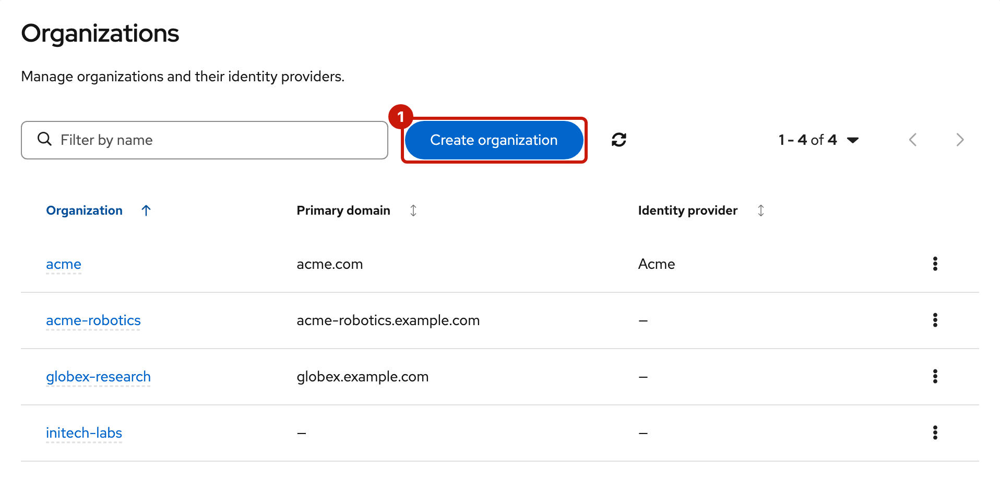
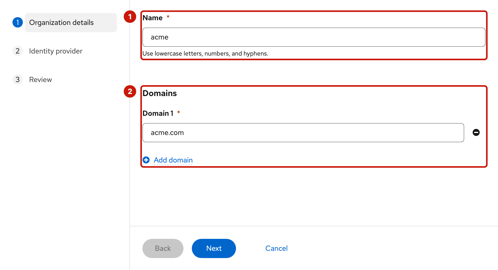
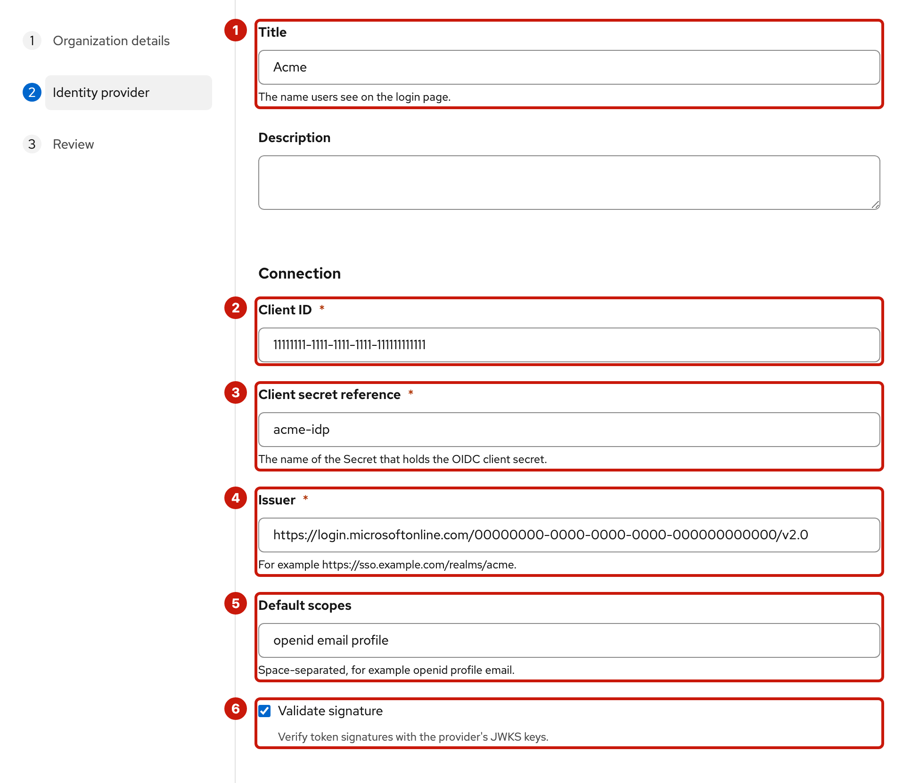
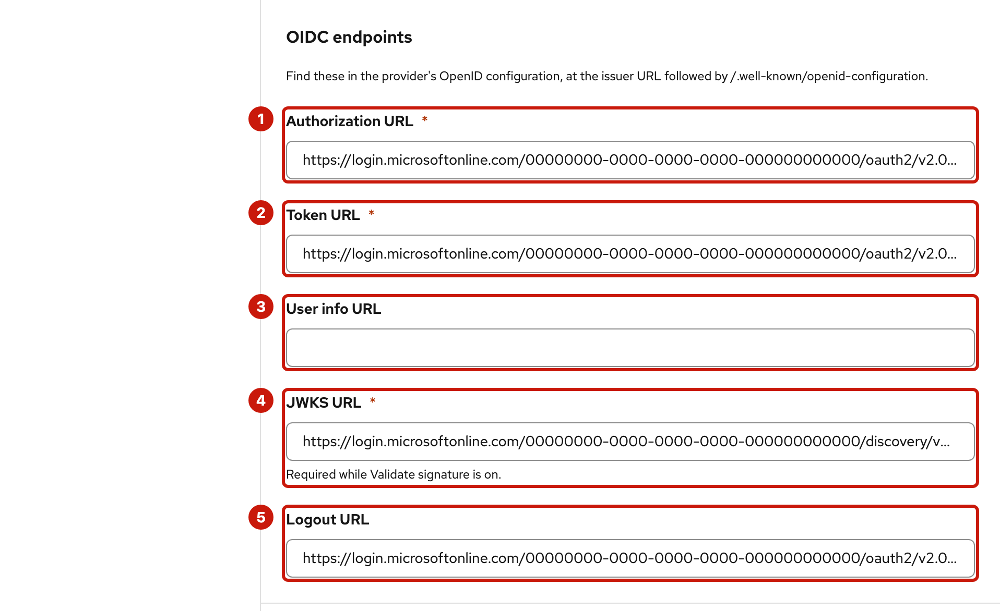
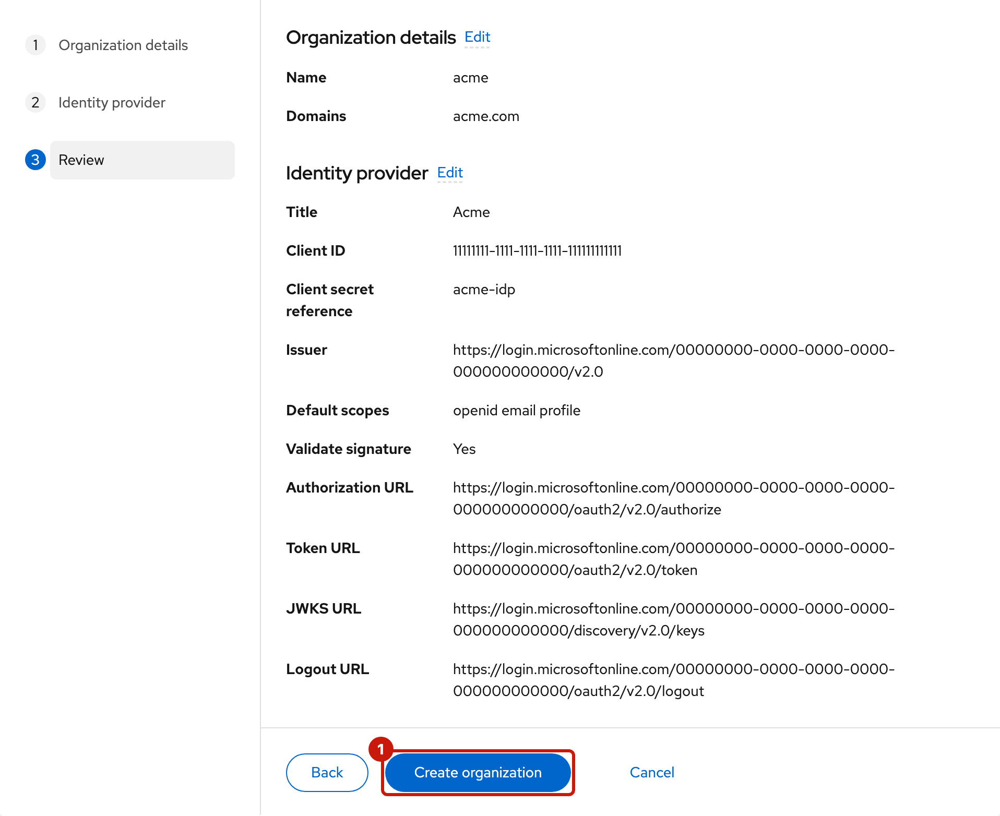
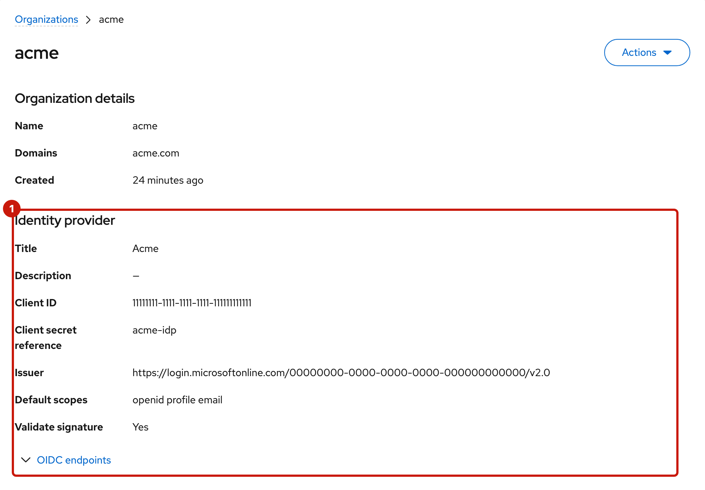
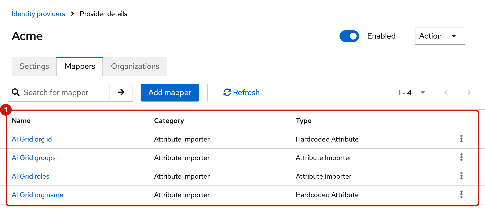
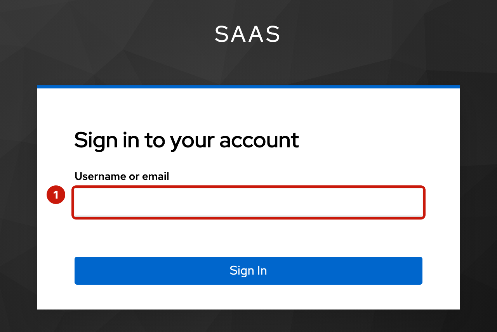
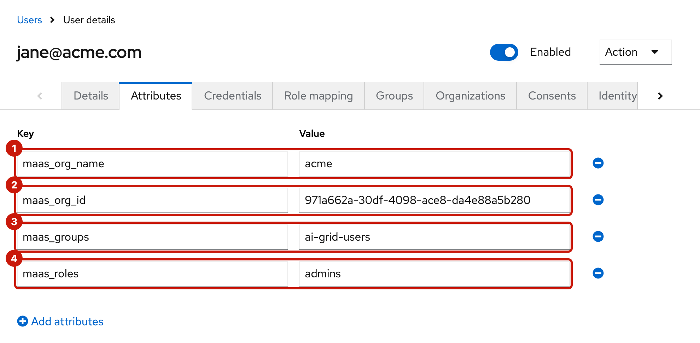

# Organization identity providers

An organization's users sign in to the MaaS portal with their own identity provider: the organization's Microsoft Entra ID, Okta, Keycloak or similar. The provider admin connects it once, in the provider console. Keycloak (realm `saas` on the hub) brokers the sign-in; AI Grid never manages the organization's users.

- [Microsoft Entra ID](entra-id.md)
- [Google](google.md): testing only, it can't send groups or roles.



## What the identity provider must send

The token that MaaS reads follows [ODH-ADR-MS-0007](https://github.com/opendatahub-io/architecture-decision-records/blob/main/architecture-decision-records/model-serving/ODH-ADR-MS-0007-ai-grid-shared-oidc-identity-contract.md). Keycloak builds it from the identity provider's ID token, which must carry:

| Claim | Value | Used for |
| --- | --- | --- |
| `sub` | A stable id for the user | Links the user's account in `saas` to the identity provider. It must never change. |
| `email` | The user's email | The user's account in `saas`; its domain decides organization membership. |
| `groups` | The user's group names, plain (`ai-grid-users`) | Subscriptions grant models to group names. |
| `roles` | `admins` for the organization's admins | Admin features in the MaaS portal. |

AI Grid's mappers in Keycloak add `org_id` and `org_name` for the organization: the identity provider doesn't send them.

Keycloak copies `groups` and `roles` at every sign-in through the identity provider, so a change at the identity provider takes effect at the user's next sign-in. A session that's already open, and its token refreshes, keep the old values until then.

**Verified email.** The MaaS portal refuses a user whose email isn't verified. Keycloak trusts the identity provider's email:

- With `email_verified` in the ID token, Keycloak copies it at every sign-in, so it must be `true`.
- Without it, Keycloak marks the email verified when it creates the user or when the email changes, and leaves the flag as it is at later sign-ins.
- With a User info URL set, Keycloak calls it at every sign-in, and its `email_verified` replaces the ID token's; a response with an email but no `email_verified` makes the email unverified. Leave the User info URL empty for an identity provider whose user info response lacks it, such as Entra ID.

## Connect an identity provider in the provider console

Do these steps for every organization. Each identity provider's page gives its own values.

### 1. Choose the organization's name

The name becomes the Keycloak identity provider's alias, and the alias is part of the redirect URI the identity provider must allow:

```
https://<keycloak-host>/realms/saas/broker/<organization-name>/endpoint
```

- `<organization-name>`: lowercase letters, digits and hyphens, at most 63 characters, for example `acme`. The console doesn't let you change it later, and the alias never changes.
- `<keycloak-host>`: the host of the hub's Keycloak Route, `oc -n maas-db get route keycloak -o jsonpath='{.spec.host}'`.

### 2. Register the client at the identity provider

Create an OIDC client (a confidential web application) with the redirect URI from step 1, and set it up to send the claims above. Keycloak authenticates to the identity provider's token endpoint by posting the client secret (`client_secret_post`). Keep the client ID and client secret.

### 3. Store the client secret on the hub

The console's backend reads identity provider client secrets from Secrets in namespace `ai-grid-idp-secrets` (the chart value `backend.idpSecrets.namespace`), key `client-secret`. It copies the bytes exactly, so the value must have no trailing newline. As a hub admin:

```sh
oc whoami --show-server   # must be the hub
printf '%s' '<client-secret>' > <file>   # no trailing newline
oc -n ai-grid-idp-secrets create secret generic <organization-name>-idp --from-file=client-secret=<file>
rm <file>
```

### 4. Create the organization

In the provider console: **Organizations**, **Create organization** (1).



The wizard has three steps.

**Organization details**: the Name (1) and the Domains (2).



| Field | Value |
| --- | --- |
| Name | `<organization-name>` from step 1 |
| Domains | The email domains of the organization's users, for example `acme.com` (**Add domain** for more). Lowercase, at least two labels, no IP addresses, at most 64 domains. A domain belongs to one organization only. They're how users reach the identity provider at sign-in, and they can be edited later. |

**Identity provider**: the connection (1–6), then the endpoints (1–5).





| Field | Value |
| --- | --- |
| Title | The name Keycloak shows for the identity provider, for example `Acme`. Empty: the organization's name. |
| Description | Optional. |
| Client ID | From step 2 |
| Client secret reference | `<organization-name>-idp`, the Secret from step 3 |
| Issuer | The identity provider's issuer |
| Default scopes | `openid email profile` (also the default when empty) |
| Validate signature | On (the default). It needs the JWKS URL. |
| Authorization URL, Token URL, User info URL, JWKS URL, Logout URL | From the identity provider's OpenID configuration: the issuer followed by `/.well-known/openid-configuration` |

An organization can be created without an identity provider, but one can only be added at creation.

**Review**, then **Create organization** (1).



The console creates, in Keycloak, the organization, its identity provider, and the identity provider's four mappers: `AI Grid org id`, `AI Grid org name`, `AI Grid groups` and `AI Grid roles`. The organization's page then shows its details and the identity provider's settings (1) as they were at creation.



In Keycloak's admin console (realm `saas`, **Identity providers**, `<organization-name>`, **Mappers**), the four mappers (1):



The identity provider's settings can't be changed in the console afterwards, and the backend copies the client secret into Keycloak only at creation. To change a setting later, such as a rotated client secret, change it in Keycloak's admin console (realm `saas`, **Identity providers**, `<organization-name>`), and update the Secret on the hub to match. Saving the organization in the console (its domains) doesn't touch the identity provider or its mappers.

### 5. Sign in

Open the MaaS portal on an ingress cluster, `https://maas.<cluster-apps-domain>/maas-portal`, and enter an email with one of the organization's domains (1): Keycloak sends the user straight to the identity provider. At the first sign-in, a user whose email domain is one of the organization's domains joins the organization as a managed member.



To check what a user got, in Keycloak's admin console (realm `saas`): **Users**, the user, **Attributes**. `maas_org_name` (1), `maas_org_id` (2), `maas_groups` (3) and `maas_roles` (4) become the token's `org_name`, `org_id`, `groups` and `roles`.



### 6. Grant models

In the provider console, create a subscription for the organization with the group names its identity provider sends. Users in those groups see the subscription's models in the MaaS portal.

## Troubleshooting

| What you see | Why, and what to do |
| --- | --- |
| The identity provider shows `redirect_uri_mismatch` (Google) or `AADSTS50011` (Entra) | The redirect URI isn't registered exactly as in step 1: `https`, the organization's name, no trailing slash. |
| Keycloak shows "We are sorry…" after the identity provider's sign-in | Keycloak couldn't get the token, most often a wrong client secret, such as one with a trailing newline. Keycloak's log has `IDENTITY_PROVIDER_LOGIN_ERROR`. Fix the secret in Keycloak ([step 4](#4-create-the-organization)). |
| Create organization fails with `identity provider secret "<name>" not found` | The Secret isn't in `ai-grid-idp-secrets`, or has another name. Create it and retry: nothing was left behind. |
| Create organization fails with `tenant "<name>" already exists` | The name, or one of the domains, is already used by another organization. |
| "Account already exists" at the first sign-in | A `saas` user with the same email already exists, for example one created by hand. Remove or link that user in Keycloak. |
| The portal refuses the user after sign-in | The email isn't verified: see [Verified email](#what-the-identity-provider-must-send). |
| The user sees no models | `maas_groups` doesn't hold the subscription's group names, or the user hasn't signed in again since the change. |
| A user who enters an email with no organization's domain sees other organizations' sign-in buttons | Keycloak lists every identity provider that isn't hidden on that page. Use a neutral Title. |
