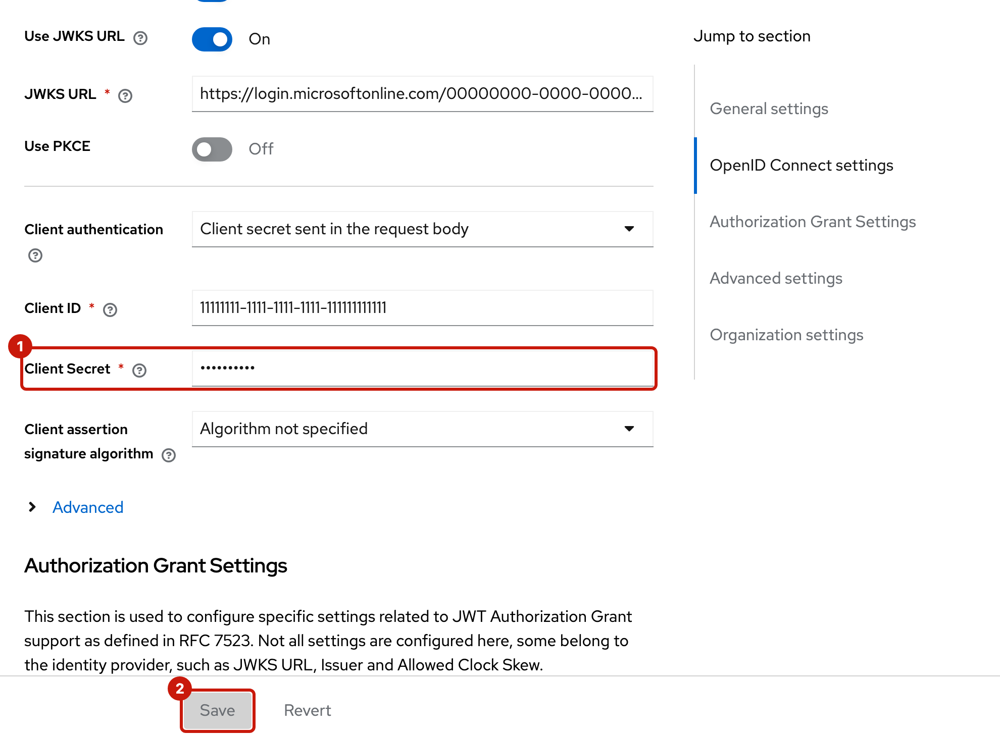

# Microsoft Entra ID

Connect an organization's Microsoft Entra ID tenant, so its users sign in to the MaaS portal with their Entra accounts. Entra sends what AI Grid needs: `roles` from app roles, and `groups` from group claims. This page fills in Entra's side of [the general steps](README.md#connect-an-identity-provider-in-the-provider-console).

| Placeholder | Example | Where it comes from |
| --- | --- | --- |
| `<organization-name>` | `acme` | You choose it ([step 1](README.md#1-choose-the-organizations-name)). |
| `<keycloak-host>` | `keycloak-maas-db.apps.hub.example.com` | `oc -n maas-db get route keycloak -o jsonpath='{.spec.host}'` on the hub |
| `<tenant-id>` | `00000000-0000-0000-0000-000000000000` | The app registration's **Overview**, Directory (tenant) ID |
| `<client-id>` | `11111111-1111-1111-1111-111111111111` | The app registration's **Overview**, Application (client) ID |
| `<email-domain>` | `acme.com` | The domain of the organization's users' emails |

## In the Microsoft Entra admin center

The organization's Entra admin does these steps, as at least a Cloud Application Administrator.

### 1. Register the application

**Entra ID**, **App registrations**, **New registration** ([Microsoft: register an app](https://learn.microsoft.com/en-us/entra/identity-platform/quickstart-register-app)):

- **Name:** for example `AI Grid MaaS`.
- **Supported account types:** **Single tenant only** (accounts in this organizational directory only). The issuer below names this one tenant.

Then, in the new registration:

- **Authentication**, **Add Redirect URI**, platform **Web**: `https://<keycloak-host>/realms/saas/broker/<organization-name>/endpoint` ([Microsoft: add a redirect URI](https://learn.microsoft.com/en-us/entra/identity-platform/how-to-add-redirect-uri)). Add `https://<keycloak-host>/realms/saas/broker/<organization-name>/endpoint/logout_response` as well, for sign-out.
- **Certificates & secrets**, **New client secret**. Copy its **Value**, not its Secret ID: Entra shows it only on this page ([Microsoft: app credentials](https://learn.microsoft.com/en-us/entra/identity-platform/how-to-add-credentials)). A secret lasts at most 24 months; note when it expires and [rotate it](#rotate-the-client-secret) before.
- **Overview:** copy the Application (client) ID and the Directory (tenant) ID.

### 2. Send `roles`: app roles

**App roles**, **Create app role**, twice ([Microsoft: app roles](https://learn.microsoft.com/en-us/entra/identity-platform/howto-add-app-roles-in-apps)):

| Display name | Allowed member types | Value |
| --- | --- | --- |
| AI Grid admins | Users/Groups | `admins` |
| AI Grid users | Users/Groups | `users` |

The **Value** is what the ID token's `roles` claim carries, so it must be exactly `admins` for the organization's admins.

### 3. Choose who may sign in, and their roles

**Entra ID**, **Enterprise applications**, the application ([Microsoft: assign users and groups](https://learn.microsoft.com/en-us/entra/identity/enterprise-apps/assign-user-or-group-access-portal)):

- **Properties**, **Assignment required?** = **Yes**. Otherwise every user in the tenant can sign in, with no roles ([Microsoft: application properties](https://learn.microsoft.com/en-us/entra/identity/enterprise-apps/application-properties)).
- **Users and groups**, **Add user/group**: choose users or groups and a role. The organization's admins get **AI Grid admins**.

Assigning **groups** needs Microsoft Entra ID P1 or P2, and only direct members of an assigned group count. Without P1, assign users one by one.

### 4. Send `groups`: group claims

**Token configuration**, **Add groups claim** ([Microsoft: group claims](https://learn.microsoft.com/en-us/entra/identity/hybrid/connect/how-to-connect-fed-group-claims)). Choose one:

- **Groups assigned to the application** (recommended, needs P1 or P2). Only groups assigned in step 3 are sent, and only to their direct members. To send them by **display name**, such as `ai-grid-users`, instead of by object id: in **Manifest**, add `cloud_displayname` to the `groups` optional claim of the ID token ([Microsoft: optional claims](https://learn.microsoft.com/en-us/entra/identity-platform/optional-claims)):

  ```json
  "optionalClaims": {
    "idToken": [
      { "name": "groups", "additionalProperties": ["cloud_displayname"] }
    ]
  }
  ```

  Display names work for cloud-only groups; groups synced from on-premises Active Directory still come by object id.
- **Security groups.** Every security group the user belongs to, nested ones included, is sent by **object id**. A subscription then names each group by its object id, such as `22222222-2222-2222-2222-222222222222`.

With more than 200 groups in one token, Entra leaves the `groups` claim out and sends a pointer to Microsoft Graph instead, which Keycloak doesn't follow: the user gets no groups in AI Grid. With **Groups assigned to the application**, only the assigned groups count toward the 200.

### 5. Send `email`

The `email` scope makes Entra put the user's email (their mail attribute) in the ID token, when the user has one ([Microsoft: ID token claims](https://learn.microsoft.com/en-us/entra/identity-platform/id-token-claims-reference)). Entra sends no `email_verified` claim, so Keycloak marks the email verified when it creates the user ([Verified email](README.md#what-the-identity-provider-must-send)). That's also why the **User info URL** stays empty below: Entra's user info response has no `email_verified` either, nor `groups` or `roles`.

## On the hub

Store the client secret's **Value**, with no trailing newline ([step 3](README.md#3-store-the-client-secret-on-the-hub)):

```sh
printf '%s' '<client-secret-value>' > <file>
oc -n ai-grid-idp-secrets create secret generic <organization-name>-idp --from-file=client-secret=<file>
rm <file>
```

## In the provider console

**Organizations**, **Create organization** ([step 4](README.md#4-create-the-organization), with screenshots of each wizard step):

| Field | Value |
| --- | --- |
| Name | `<organization-name>` |
| Domains | `<email-domain>` |
| Title | For example `Acme` |
| Client ID | `<client-id>` |
| Client secret reference | `<organization-name>-idp` |
| Issuer | `https://login.microsoftonline.com/<tenant-id>/v2.0` |
| Default scopes | `openid email profile` |
| Validate signature | On |
| Authorization URL | `https://login.microsoftonline.com/<tenant-id>/oauth2/v2.0/authorize` |
| Token URL | `https://login.microsoftonline.com/<tenant-id>/oauth2/v2.0/token` |
| User info URL | Leave empty |
| JWKS URL | `https://login.microsoftonline.com/<tenant-id>/discovery/v2.0/keys` |
| Logout URL | `https://login.microsoftonline.com/<tenant-id>/oauth2/v2.0/logout` |

These come from `https://login.microsoftonline.com/<tenant-id>/v2.0/.well-known/openid-configuration`.

## Check

1. Sign in to the MaaS portal as one of the organization's admins ([step 5](README.md#5-sign-in)).
2. In Keycloak's admin console (realm `saas`), the user's **Attributes** show `maas_roles` = `admins` and `maas_groups` = their groups.
3. Create a subscription for the organization with those group names ([step 6](README.md#6-grant-models)), and check that the portal lists its models.

| If | Then |
| --- | --- |
| `maas_roles` is empty | The user has no app role assignment (step 3). |
| `maas_groups` is empty | The user isn't a direct member of a group assigned to the application, or has more than 200 groups with **Security groups** chosen. |
| `maas_groups` holds ids, not names | `cloud_displayname` isn't set, or the groups are synced from on-premises. |
| Entra shows `AADSTS50011` | The redirect URI doesn't match (step 1). |
| Entra says the user isn't assigned | **Assignment required?** is on and the user has no assignment: that's working as intended. |

## Rotate the client secret

The backend copies the client secret into Keycloak only when it creates the organization, so a new secret goes into Keycloak directly:

1. In the app registration, **Certificates & secrets**: create a new client secret and copy its **Value**.
2. In Keycloak's admin console (realm `saas`): **Identity providers**, `<organization-name>`, **Settings**: paste the new value in **Client Secret** (1), then **Save** (2), which turns active once the field changes.

   
3. On the hub, update the Secret to match:

   ```sh
   printf '%s' '<new-client-secret-value>' > <file>
   oc -n ai-grid-idp-secrets create secret generic <organization-name>-idp --from-file=client-secret=<file> \
     --dry-run=client -o yaml | oc apply -f -
   rm <file>
   ```

4. Once sign-ins work, delete the old secret in Entra.

Microsoft recommends certificates over client secrets for production apps; Keycloak's broker here uses a client secret.
