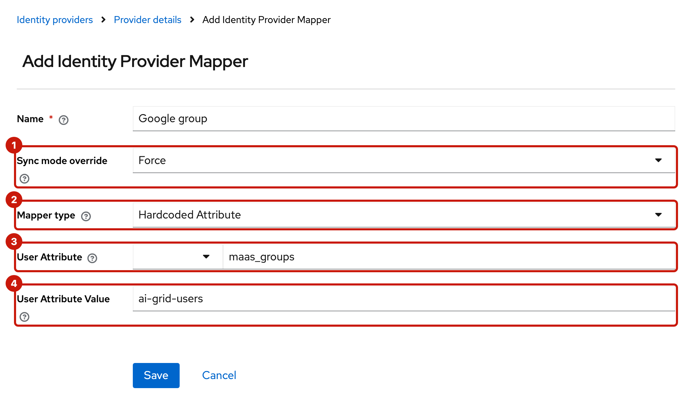

# Google

**For testing only.** Google signs users in, but its OpenID Connect ID tokens never carry `groups` or `roles` ([Google: OpenID Connect](https://developers.google.com/identity/openid-connect/openid-connect)). A Google user joins the organization with no groups and no roles: no subscription matches them, and none of them is an admin. To test with Google anyway, give every Google user of the organization one fixed group and role in Keycloak ([Fixed group and role](#fixed-group-and-role)).

This page fills in Google's side of [the general steps](README.md#connect-an-identity-provider-in-the-provider-console).

## In Google Cloud Console

**Google Auth Platform**, in a Google Cloud project:

1. **Branding:** the app name and a support email. Google requires it before you can create a client.
2. **Audience** ([Google: manage app audience](https://support.google.com/cloud/answer/15549945)):
   - **Internal**, if the project belongs to your Google Workspace or Cloud Identity organization: only its accounts can sign in.
   - Otherwise **External** in **Testing** mode, with each test account added as a test user (at most 100).
3. **Clients**, **Create client** ([Google: manage OAuth clients](https://support.google.com/cloud/answer/15549257)):
   - Application type: **Web application**.
   - Authorized JavaScript origins: none.
   - Authorized redirect URIs: `https://<keycloak-host>/realms/saas/broker/<organization-name>/endpoint`.
4. **Create**, and download the client's JSON in that dialog: Google shows the full client secret only once. `web.client_id` is the client ID and `web.client_secret` the secret. If the secret is lost, add a new one in the client and disable the old one.

Changes to redirect URIs can take from 5 minutes to a few hours to apply, so a `redirect_uri_mismatch` right after creating the client may only mean waiting.

## On the hub

```sh
F=<downloaded JSON>
jq -j .web.client_secret "$F" | oc -n ai-grid-idp-secrets create secret generic <organization-name>-idp --from-file=client-secret=/dev/stdin
jq -r .web.client_id "$F"   # the client ID for the console
rm "$F"
```

`jq -j` writes the secret without a trailing newline. If `.web` is missing, the client isn't a Web application.

## In the provider console

| Field | Value |
| --- | --- |
| Name | `<organization-name>` |
| Domains | The domain of the Google accounts, for example `example.com` for a Workspace. Not `gmail.com` on a shared hub: every `@gmail.com` user would be routed to this organization. Not `google.com`: it only matches Google's own employees. |
| Title | `Google` |
| Client ID | `web.client_id` |
| Client secret reference | `<organization-name>-idp` |
| Issuer | `https://accounts.google.com` |
| Default scopes | `openid email profile` |
| Validate signature | On |
| Authorization URL | `https://accounts.google.com/o/oauth2/v2/auth` |
| Token URL | `https://oauth2.googleapis.com/token` |
| User info URL | `https://openidconnect.googleapis.com/v1/userinfo` |
| JWKS URL | `https://www.googleapis.com/oauth2/v3/certs` |
| Logout URL | Leave empty: Google has none |

These come from `https://accounts.google.com/.well-known/openid-configuration`. Google sends `email_verified` both in the ID token and from its user info endpoint.

## Fixed group and role

A Keycloak admin on the hub, in realm `saas`: **Identity providers**, `<organization-name>`, **Mappers** ([the four mappers](README.md#4-create-the-organization) the console created).

1. Delete `AI Grid groups` and `AI Grid roles`. They import the `groups` and `roles` claims at every sign-in with sync mode Force, and Google sends neither, so they'd clear anything set by hand. Keep `AI Grid org id` and `AI Grid org name`.
2. **Add mapper**, twice: **Sync mode override** **Force** (1), **Mapper type** **Hardcoded Attribute** (2), then the **User Attribute** (3) and its **User Attribute Value** (4):
   - name `Google group`, User Attribute `maas_groups`, User Attribute Value `ai-grid-users`;
   - name `Google role`, User Attribute `maas_roles`, User Attribute Value `admins`.

   
3. Sign out of the MaaS portal and sign in with Google again. The user's **Attributes** (**Users**, the user) now include `maas_groups` and `maas_roles`.
4. In the provider console, create a subscription for the organization with group `ai-grid-users`.

Limits:

- Every Google user of the organization is an admin in `ai-grid-users`.
- It's a hand edit on the hub that nothing tracks. Saving the organization in the provider console leaves it alone; renaming the organization through the backend's API would write `AI Grid groups` and `AI Grid roles` again. Don't keep both kinds of mapper on one attribute: Keycloak runs them in no fixed order.

Using Google for a real organization needs a setting in the provider console and its backend, such as a default group and role for every user of the identity provider, or a list of admin emails.
